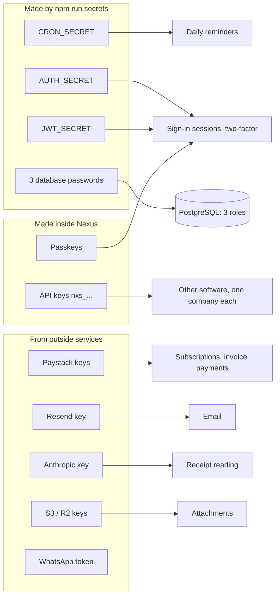

# Keys and secrets

Every setting Nexus reads, what it is for, and where its value comes from. Put the values in your host's environment
settings (on Vercel: Project > Settings > Environment Variables), never in a file you commit.

- **Make your own** values come from `npm run secrets`. Run it on your own computer and copy the values from the file it
  writes. It never prints them.
- **From a service** values come from that company's dashboard.
- **Public** values are not secret. Anyone can see them in the browser.

## Must have before going live

| Key | Kind | What it does | Where to get it | Changing it |
|---|---|---|---|---|
| `APP_URL` | Public | The site address, with no trailing slash. Used for links in emails, the API docs and passkeys. | Your domain, for example `https://nexusledger.co.za` | Passkeys only work on the domain they were added on. If the domain changes, people add their passkeys again. |
| `AUTH_SECRET` | Make your own | Signs the sign-in cookie. | `npm run secrets` | Everyone is signed out. |
| `JWT_SECRET` | Make your own | Signs sign-in tokens and locks the stored two-factor secrets. | `npm run secrets` | Everyone is signed out, and anyone using two-factor must set it up again. |
| `DATABASE_URL` | Make your own (password) | The app's own connection. Row-level security keeps each company separate. | `npm run secrets` writes it; run `secrets.local.sql` so the password matches | Run `ALTER ROLE nexus_app PASSWORD '…'`, then update this. |
| `AUTHN_DATABASE_URL` | Make your own (password) | The sign-in connection. It can look people up by email before knowing their company. | as above (`nexus_authn`) | as above |
| `SERVICE_DATABASE_URL` | Make your own (password) | The billing and webhook connection. | as above (`nexus_service`) | as above |
| `DIRECT_URL` | From your database host | The owner connection. Only builds and migrations use it, never the running app. | The database provider (Neon or Supabase): direct, not pooled | Change it in the provider, then here. |

In production the server will not issue sign-ins while `AUTH_SECRET` or `JWT_SECRET` is still the example value or is
shorter than 32 characters.

## Turn on when you need them

| Key | Kind | What it does | Where to get it |
|---|---|---|---|
| `CRON_SECRET` | Make your own | Protects `/api/cron/daily`, the daily payment reminders. | `npm run secrets` |
| `PAYSTACK_SECRET_KEY` | From a service | Takes subscription payments and payments on customer invoices. It also checks Paystack's webhooks. | Paystack > Settings > API Keys & Webhooks. Use `sk_test_…` while testing and `sk_live_…` to go live. |
| `PAYSTACK_PLAN_CODE`, `PAYSTACK_PLAN_CODE_MULTI` | From a service | The R250 and R470 monthly plans. | Paystack > Products > Plans |
| `PLAN_PRICE_ZAR`, `PLAN_PRICE_MULTI_ZAR` | Public | The prices shown on the billing page. | Must match the Paystack plans. |
| `RESEND_API_KEY` | From a service | Sends emails: invoices, reminders, password resets and invitations. | resend.com > API Keys. Verify your domain there first. |
| `EMAIL_FROM` | Public | The sender, for example `Nexus Ledger <hello@your-domain.co.za>`. | An address on the domain you verified with Resend |
| `ANTHROPIC_API_KEY` | From a service | Reads receipt photos. | console.anthropic.com > API Keys |
| `S3_BUCKET`, `S3_REGION`, `S3_ENDPOINT`, `S3_ACCESS_KEY_ID`, `S3_SECRET_ACCESS_KEY` | From a service | Stores attachments. Without these, files go on the server's own disk, which Vercel wipes. | Cloudflare R2 > Manage API tokens, or AWS IAM |
| `WHATSAPP_ACCESS_TOKEN`, `WHATSAPP_PHONE_NUMBER_ID` | From a service | Sends payment reminders on WhatsApp. | Meta for Developers > WhatsApp > API Setup |
| `WHATSAPP_VERIFY_TOKEN` | Make your own | Proves to Meta that the webhook is yours. | `npm run secrets`, then type the same value into Meta's webhook settings |
| `ANDROID_PACKAGE_NAME`, `ANDROID_CERT_SHA256` | Public | Lets the Android app open the site full screen. | The signing key fingerprint from the Android build. See DEPLOY.md. |

## New in 2.4: API, passkeys and the map

| Key | Kind | Default | What it does |
|---|---|---|---|
| `API_RATE_LIMIT` | Public | `300` | Requests per minute allowed for each API key. |
| `WEBAUTHN_RP_ID` | Public | hostname of `APP_URL` | The domain passkeys belong to. Set it to the parent domain (`nexusledger.co.za`) if the app runs on a subdomain and you want passkeys to work on both. |
| `WEBAUTHN_ORIGIN` | Public | `APP_URL` | The exact address the sign-in page is served from. |
| `GEOCODER_URL` | Public | `https://nominatim.openstreetmap.org` | Turns addresses into map pins. Accepts any service that speaks Nominatim's `/search` API. |
| `GEOCODER_USER_AGENT` | Public | `NexusLedger/2 (…)` | OpenStreetMap's policy asks you to name your app and give a contact, for example `NexusLedger/2 (support@your-domain.co.za)`. |
| `GEOCODER_COUNTRY` | Public | `za` | Limits address lookups to one country. Leave it empty to search everywhere. |
| `NEXT_PUBLIC_MAP_TILE_URL` | Public | OpenStreetMap tiles | The map background. Set it before you build, because it is built into the page. |
| `NEXT_PUBLIC_MAP_ATTRIBUTION` | Public | `© OpenStreetMap contributors` | Credit for the map. Required by every tile provider. |

**OpenStreetMap's free services are for light use.** Nexus looks up one address at a time, only when someone presses
*Find from address*, and at most once a second, which fits Nominatim's usage policy. If you have many customers, or
outgrow the free tiles, switch to a provider such as MapTiler, Stadia Maps, LocationIQ or Geoapify. Set
`NEXT_PUBLIC_MAP_TILE_URL` (with their key in the URL, since tile keys are public by design and locked to your domain in
their dashboard) and `GEOCODER_URL`.

## Keys made inside Nexus

- **API keys** (Settings > API keys, owners and admins). Each key starts with `nxs_`, works for one company and is shown
  once. Nexus keeps only a SHA-256 hash, so a database leak cannot be used to call the API. Revoking a key stops it at once.
  A read-only key acts as a Viewer; a read-and-write key acts as an Accountant. No key can manage people, billing, other
  keys or sign-in. The API is documented at `/developers`.
- **Passkeys** (Settings > Security). Each person adds their own. The device keeps the private key; Nexus stores only the
  public key, which is not a secret.

## Development and build-only settings

`NODE_ENV`, `DISABLE_RATE_LIMIT`, `MAIL_OUTBOX_DIR`, `UPLOAD_DIR`, `DB_POOL_MAX`, `SKIP_MIGRATIONS`, `NEXUS_VERSION`,
`NEXUS_COMMIT`, `NEXUS_BUILT_AT`, `NEXUS_MIGRATIONS` and the `UPDATE_*` settings are described in DEPLOY.md and the
README. None of them is a secret, except `UPDATE_CHECK_TOKEN`, a GitHub token used only if your releases are private.

## If a secret leaks

1. Make a new one (`npm run secrets`, or the service's dashboard) and put it in your host's settings.
2. Revoke the old one at the service: in Paystack, Resend, Anthropic, R2 or Meta, roll or delete the key.
3. Redeploy. For a database password, run `ALTER ROLE … PASSWORD` first.
4. If `JWT_SECRET` leaked, also ask everyone with two-factor to set it up again.
